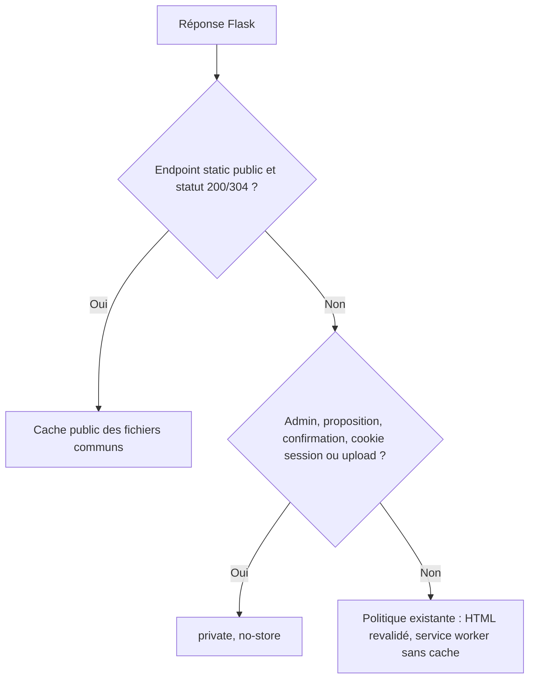

# Correction du cache et du logo DEV — 11 novembre 2026

Version 1.0. Contrat rédigé avant les tests et le code ; réalisation et preuves
à compléter après exécution.

## Autorisation et références

L’utilisateur demande de corriger le cache et d’alléger le logo sur DEV en
conservant la protection des pages privées. Le fonctionnement imposé est :
branche dédiée depuis le dernier `dev` → documentation/critères → tests de
régression rouges → correction/tests verts → revue → fusion `dev` → publication
du commit exact et vérification. `main`, production, données et interface sont
hors modification. Source de départ : `765663fe9162`.

Les contrats de confidentialité existent dans `../ux/REFONTE_DEV.md`
(critère 4, médias) et `../testing/REFONTE_DEV_2026-11-11.md`. Il manquait une
fiche technique distinguant fichiers statiques publics et réponses privées ;
le présent correctif précise cette distinction, sans modifier les parcours.
Le dessin et le cadrage du logo retenu restent identiques ; seule une copie
redimensionnée et compressée est utilisée pour son affichage à 44 × 44 px.

## Défaut observé et règle corrigée

Sur DEV, un cookie `session` entraîne `private, no-store` jusque sur les CSS,
polices et images publiques. Nginx transmet ces ressources à Flask. Le logo
commun fait 1 172 884 octets pour 1254 × 1254 px. Les HTML mesurés depuis le
serveur répondent en environ 20–90 ms ; cela ne mesure pas le rendu du téléphone.

L’exception de cache s’applique exclusivement aux réponses statiques publiques
réussies (200 et validation conditionnelle 304), indépendantes de la session.
Les médias `/static/uploads/...` ont leur propre endpoint contrôlant la
publication et ne font pas partie de cette exception.

La relecture préalable identifie aussi le renouvellement automatique des
sessions admin permanentes par Flask après le hook HTTP : il pose Set-Cookie et
Vary: Cookie même sur un fichier commun. Ne suspendre ce renouvellement que sur
un statique réussi dont la session n’a été ni consultée ni modifiée ; le conserver sur les
documents privés et toute mutation de session. Les autres statuts statiques
(erreurs, réponse partielle 206) restent explicitement sans stockage. Les autres
dimensions Vary, notamment Accept-Encoding, ne sont pas supprimées.

## Critères d’acceptation

| ID | Contrat à vérifier |
| --- | --- |
| CACHE-01 | CSS, JS, police et logo publics conservent un cache navigateur avec cookie visiteur invalide ou session admin permanente valide ; ni contenu de session, ni Set-Cookie, ni Vary: Cookie dans ces fichiers. Le renouvellement de session continue sur les documents privés et lors d’une mutation. |
| CACHE-02 | GET et HEAD restent cohérents ; une revalidation ETag renvoie 304 avec la même politique publique. Une erreur ou réponse partielle de fichier statique n’est jamais annoncée publiquement cacheable. |
| CACHE-03 | Admin (page et redirection anonyme), proposition, confirmation et HTML avec session restent privés et `no-store`. Le service worker garde `no-store`. |
| CACHE-04 | Les uploads publiés comme les portraits privés autorisés restent `private, no-store` ; un portrait brouillon/archivé reste inaccessible anonymement. |
| CACHE-05 | Logo d’interface et favicon utilisent une nouvelle URL de copie PNG ≤ 60 Kio, au moins 132 × 132 px pour l’affichage 44 px à densité 3. Le fichier original reste disponible pour les métadonnées sociales et l’historique. Dessin, proportions, fond et couleurs conservés ; aucun générateur d’image. |
| CACHE-06 | Suites applicative et livraison, compilation, démarrage, contrôle visuel et vérifications DEV effectives réussis ; Basic, non-indexation et production préservés. |

Les tests doivent d’abord échouer sur CACHE-01 et CACHE-05 avec le code initial.
Ils utilisent uniquement des bases, sessions et uploads temporaires. La revue
vérifie notamment qu’une URL contenant `/static` ne suffit pas à autoriser le
cache : l’endpoint et le statut doivent correspondre à un fichier public.

## Livraison et récupération

Branche `codex/cache-logo-dev-20261111`. Application de `VPS_DEV_ROUTING.md`,
section refonte DEV : arbre propre, archive exacte, capacité disque, tests dans
l’image, migration sur copie sans changement attendu, snapshot DB + uploads
avant bascule du seul `web_dev`, smoke et contrôle Nginx partagé. Aucun nettoyage
de disque implicite ni `--allow-db-change` prévu. Sauvegarde indépendante et
restauration vérifiées avant la migration active selon la procédure existante.

Une nouvelle URL du petit logo évite les anciennes copies publiques conservées
un an. Les CSS/JS ont déjà un paramètre de version. Aucun cache de documents ou
d’uploads ajouté au service worker ; aucun changement de droits de publication.

## Réalisation et résultats locaux

- Règles et schéma ci-dessus rédigés avant tests puis code.
- Rouge : les 11 tests de `tests/test_static_cache_privacy.py` produisent
  13 échecs d’assertion avec le backend initial, sans erreur d’exécution après
  mise au point des fixtures. Ils reproduisent cache avec session, 404 statique,
  logo lourd et mutation de session sur un statique ; les protections privées
  déjà correctes passent avant modification.
- Vert : mêmes contrats réussis après correction. Suite applicative complète :
  140 cas découverts, 139 réussis et un cas manuel historique ignoré.
  Suite de livraison : 49 tests réussis ; compilation applicative/scripts et
  `git diff --check` réussis. Journaux privés de recette dans
  `/tmp/reunion-cache-qa-20261111/` (`red.log`, `app-tests.log`, `script-tests.log`).
- Implémentation : `http_handlers.py` distingue l’endpoint statique public des
  autres réponses. `session_interface.py`, câblé dans `app.py`, conserve le
  fonctionnement Flask et ne renouvelle pas une session inutilisée sur un
  statique réussi ; toute consultation ou mutation réactive le comportement
  privé et la sauvegarde de session. Aucun effacement global de Vary.
- Copie déterministe par rééchantillonnage Lanczos/PNG optimisé : original
  RGB 1254 × 1254 de 1 172 884 octets ; nouveau RGB 144 × 144 de 17 516 octets
  (−98,51 %). `base.html` utilise cette nouvelle URL pour l’en-tête et le favicon,
  en conservant l’original pour `og:image`.
- Relecture indépendante : aucun défaut bloquant. Vérification séparée avec
  session admin permanente et lecture de session dans une vue statique : repli
  privé effectif, renouvellement privé maintenu.
- Navigateur IAB sur Gunicorn local et base vierge jetable : FAQ rendue, logo
  chargé 144 × 144 et affiché 44 × 44, visuellement propre dans l’en-tête PC.
  Aucun test sur téléphone physique ni mesure de navigation sur le téléphone.

## Récupération et preuves de livraison

Avant publication : nouveau snapshot cohérent DB + uploads vérifié sur le VPS.
L’ouverture SQLite depuis un nouveau montage strictement en lecture seule a
échoué ; le snapshot a ensuite réussi depuis le conteneur actif par l’API backup,
en dehors de `/data`, sans mutation métier.

Le contrôle automatique a refusé un nouveau transfert du bundle privé vers le
PC. Aucun contournement : la sauvegarde déjà présente dans
`backups/sephora-dev-20261111/after-bundle` a été vérifiée et restaurée isolément
dans `/tmp/reunion-cache-qa-20261111/restored-data`. Comparaison des empreintes
logiques SQLite et de chaque upload agrégé avec le snapshot VPS frais : égalité
exacte. Intégrité OK, zéro violation de clé étrangère, 60 sites, 30 personnalités,
zéro proposition, 34 images décodées. Ces données privées restent hors Git et
artefact. Deux lieux pour cette sauvegarde ponctuelle ; pas de troisième copie
ni de nouvelle planification annoncées.

La publication effective s’atteste séparément par les labels `reunionwiki.*`,
`release-info.txt` du dossier de release et les contrôles HTTP après bascule.
Les journaux de ce correctif sont conservés dans
`/tmp/reunion-cache-qa-20261111/deploy.log` et `runtime.json` ; ils doivent relier
le commit testé au commit actif et vérifier cache 200/304 avec session, absence
de Set-Cookie statique, pages privées/uploads sans stockage, Basic/non-indexation,
intégrité et données préservées, image/date de démarrage production inchangées.
La présente fiche seule ne prouve pas l’exécution d’un déploiement. Aucun
changement de base ou d’upload n’est demandé.

## Historique

| Version | Date | Modification |
| --- | --- | --- |
| 1.0 | 11 novembre 2026 | Contrat, schéma et critères avant tests et correction. |
