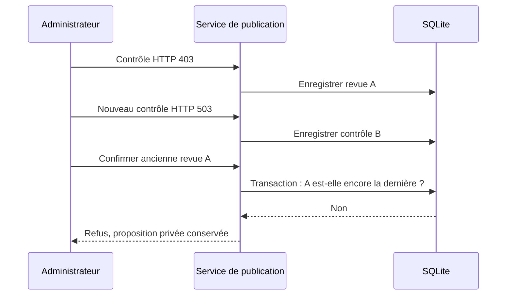
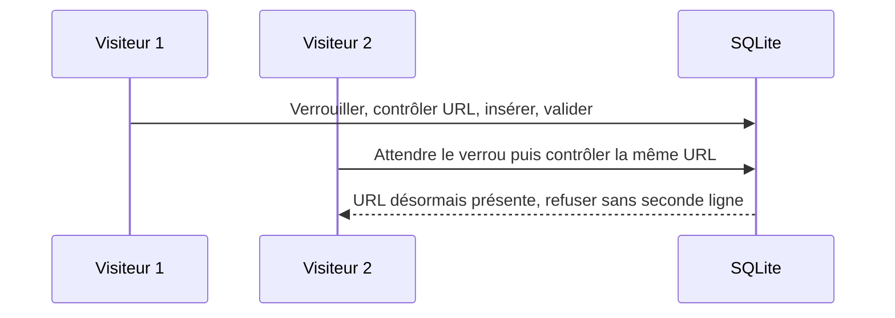
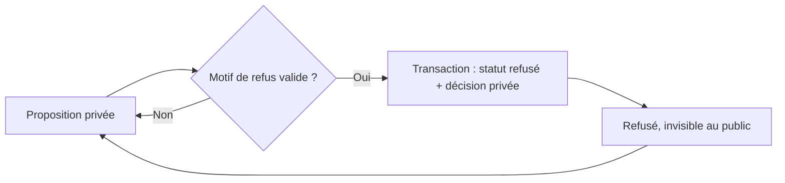

# Corrections de la soumission et de la publication — 26 octobre 2026

Version 1.0 - réalisation et vérifications locales du 26 octobre 2026.

## Autorisation, source et périmètre

Après l'audit du parcours et l'explication des quatre corrections, l'utilisateur
autorise leur réalisation le 26 octobre (« Okayy super vas-y »).
Ce lot corrige les règles existantes RM-SITE-002/003/010/011. Il ne livre pas
les nouveaux écrans publics ni la maquette Site/Personnalité (#18).

Base de travail : backend audité `b0967c2`, branche isolée
`codex/site-submission-hardening-20261026`. Main locale `44a2586` contient les
maquettes, mais pas encore ce backend en couches : pas de fusion globale de
l'ancienne branche dans main ; réconciliation #42 distincte avant livraison.
La production, ses données et la maquette en cours ne sont pas modifiées.

## Règles et choix de correction

### COR-SITE-01 — La revue HTTP doit représenter le dernier contrôle

Une confirmation manuelle porte sur le contrôle 401/403 le plus récent du site,
pour son URL courante et un état publiable. Tout nouveau contrôle remplace le
précédent, même si l'URL est identique. La vérification et la consommation sont
faites dans une même transaction d'écriture. Une confirmation consommée ne peut
être rejouée ; toutes les traces restent conservées.

### COR-SITE-02 — Les données stockées restent valides jusqu'à la publication

Vérifier les quatre champs minimaux (nom, URL HTTP(S), description, catégorie
existante) au point central de publication, pour publication HTTP automatique
comme pour confirmation manuelle. Appliquer les bornes et protections déjà
portées par le formulaire ; le contrôle ne réécrit pas silencieusement une
ancienne fiche. La décision éditoriale reste requise : aucun jugement automatique
sur la neutralité ou la légalité du contenu n'est ajouté.

La vérification se fait aussi dans la transaction finale : une modification de
la fiche après le contrôle préalable ne doit pas contourner le verrou. Le
repository fournit une unité de travail `BEGIN IMMEDIATE` et la lecture courante ;
le service valide les champs avec `services/site_data_validation.py` puis appelle
les écritures dans cette même connexion. La confirmation manuelle partage cette
unité de travail : consommation de revue et publication sont validées ensemble.
Les vérifications SQL de catégorie et d’unicité restent au point d’écriture.

### COR-SITE-03 — Contrôle du doublon et écriture atomiques

L'équivalence existante d'URL (protocole ignoré, domaine normalisé, casse du
chemin et paramètres utiles conservés) reste inchangée. Créer ou modifier une
URL impose de verrouiller l'écriture SQLite avant lecture des URL et insertion
ou modification : le second envoi voit le résultat du premier et est refusé.

Utiliser une transaction `BEGIN IMMEDIATE` et le comparateur d'URL commun dans
le repository ; ne pas ajouter une migration qui supprimerait/fusionnerait des
doublons déjà stockés. Aucun traitement du catalogue actif dans ce lot.

### COR-SITE-04 — Motif privé de refus

Tout nouveau passage vers `refuse` exige un motif parmi les six raisons déjà
définies : doublon, absence de lien réunionnais, site inaccessible, contenu
interdit/dangereux, informations insuffisantes, hors ligne éditoriale.

Conserver motif, administrateur et date dans un historique privé lié au site,
dans la même transaction que le refus. Le réexamen et l'archivage conservent cet
historique. Ne pas inventer un motif pour les refus historiques sans trace.

Le formulaire de modération et l'édition admin utilisent ces choix ; ajouter le
champ dans les composants admin existants, sans refonte ni changement de la
maquette publique. Afficher la dernière décision seulement dans l'admin. Un
refus sans motif est bloqué avec un message permettant sa correction.

## Critères et ordre TDD

1. Documenter ces règles et schémas avant les tests et le code.
2. Ajouter des tests durables qui échouent sur le backend initial ; conserver
   le journal rouge et les raisons d'échec.
3. Corriger, faire passer les mêmes assertions et relancer les suites utiles.
4. Vérifier les formulaires réellement rendus, CSRF, absence d'accès anonyme et
   confidentialité des motifs. Les changements visuels restent à distinguer
   d'une validation utilisateur.
5. Revoir le diff, documenter résultats/limites et commiter le seul lot. La
   fusion dans main est conditionnée par la réconciliation réelle du backend.

| ID de contrôle | Résultat attendu |
| --- | --- |
| COR01-OLD | 403 puis 503 puis ancienne confirmation : publication refusée, état privé et historique conservés. |
| COR01-LATEST | Une nouvelle revue 401/403 peut être confirmée une seule fois ; l'ancienne n'est plus proposée. |
| COR02-STORED | Fiches existantes invalides : aucune publication, via chemin automatique ou manuel. |
| COR02-RACE | Une modification de données après contrôle est détectée au point transactionnel. |
| COR03-CONCURRENT | Deux propositions identiques simultanées : une seule ligne, seconde requête refusée proprement. |
| COR03-EDIT | Conflit création/modification ou double modification : unicité préservée. |
| COR03-DISTINCT | Deux chemins/paramètres métier distincts restent acceptés. |
| COR04-MISSING | Refus sans motif/invalide bloqué, aucune mutation ni historique fictif. |
| COR04-ATOMIC | Refus et motif/auteur/date validés ensemble ; erreur de trace annule aussi le statut. |
| COR04-PRIVATE | Motif visible dans l'admin, absent des pages publiques et conservé après réexamen. |

## Résultat

Les quatre corrections sont réalisées et vérifiées dans la branche isolée.
La documentation et les schémas ont précédé les tests de régression, puis le code.
Les journaux rouges ont montré les défauts sur le backend initial ; les mêmes
assertions passent après correction. Une relecture indépendante a conduit à
utiliser une URL différente pour chaque sous-cas de donnée invalide : aucun
blocage anti-doublon ne doit masquer l'absence d'une autre validation. Ces cinq
tests renforcés échouent encore sur `b0967c2` (10 échecs), puis passent ici.

| Vérification finale | Résultat et portée |
| --- | --- |
| Suite applicative `script/run_app_tests.py` | 103 tests, 102 réussis, 1 ignoré ; 24 nouveaux tests durables, aucune assertion existante affaiblie. |
| Suite `python -m unittest discover -s script/tests -v` | 31 tests réussis. |
| Migration réelle sur SQLite jetable | Base neuve puis second passage avec site et historique ajoutés entre les deux ; données conservées, `integrity_check=ok`, aucune erreur `foreign_key_check`. |
| Interface réelle locale | Connexion admin, refus avec un motif, retour dans Sites puis édition ; motif, acteur et date affichés en privé. Captures ordinateur et 390 px. |
| Sécurité ciblée automatisée | Vrais jetons CSRF de formulaires rendus ; utilisateur anonyme et requête sans CSRF ne modifient pas les données ; motifs absents des pages publiques. |
| Relecture et diff | Relecture indépendante des transactions/URL ; `git diff --check` réussi. |

Les fichiers de preuve sont conservés dans Expernet :
`output/analyses/soumission-site-2026-10-26/corrections/preuves/`.
Le PDF de suivi conserve le diagnostic historique et ajoute le bilan de ce lot.

## Correspondance entre règles, code et tests

| Règle | Réalisation | Tests durables |
| --- | --- | --- |
| RM-SITE-011 / COR01 | `repositories/site_http_repository.py`, dernière revue par `MAX(id)` et consommation sous verrou | `tests/test_site_http_review_freshness.py` : 6 tests |
| RM-SITE-002 / COR02 | `services/site_data_validation.py`, service de publication, unité de travail du repository | `tests/test_site_publication_guards.py` : 5 tests |
| RM-SITE-003 / COR03 | `site_urls.py`, service URL, contrôle et écriture sérialisés au repository | `tests/test_site_atomic_urls.py` : 4 tests |
| RM-SITE-010 / COR04 | Historique privé additif, lifecycle service, formulaires et trois gabarits admin | `tests/test_site_refusal_reasons.py` : 9 tests |

## Limites et prochaine intégration

- Aucun push ni déploiement, aucune migration de base active, aucun doublon du
  catalogue actif supprimé. Les transports HTTP sont simulés dans les tests.
- La vérification de mise en page locale ne vaut pas acceptation visuelle de
  l'utilisateur, audit d'accessibilité complet ou essai sur téléphone physique.
  La navigation admin mobile existante reste horizontale ; pas de refonte ici.
- Le parcours pilote réel déjà consigné reste ignoré dans l'automatisation :
  il n'a pas été rejoué et n'est pas compté comme nouveau succès.
- Le nouveau parcours public de la maquette (accès au formulaire, champs et
  confirmation, #18) reste à intégrer séparément à Flask.
- La fusion vers main ne peut pas livrer ce lot seul : main ne contient pas les
  modules backend de la base auditée. Réconciliation #42 nécessaire avant
  intégration ; cette branche n'embarque aucune fusion globale non revue.
- Pour le dossier : expliquer un scénario avant/après, le risque de concurrence,
  le choix de transaction, les tests attendus/obtenus et ta contribution réelle.
  Ces preuves contribuent aux compétences 3, 6, 8 (SQL) et 9 ; elles ne suffisent
  pas à démontrer NoSQL, CI, déploiement ni la maîtrise personnelle.

## Historique

| Version | Date | Modification |
| --- | --- | --- |
| 1.0 | 26 octobre 2026 | Règles et schémas avant tests, quatre corrections et résultats locaux, limites d'intégration explicites. |
