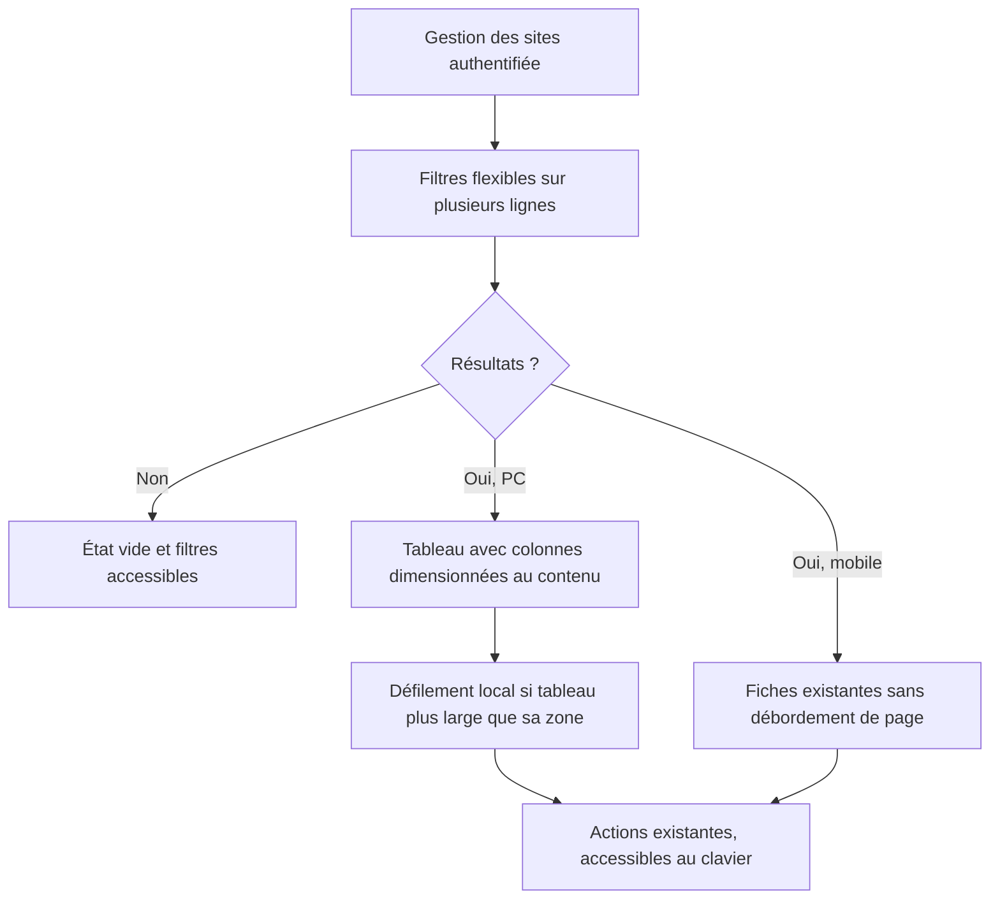

# Gestion des sites — correction de mise en page DEV

Version 1.0 — UX-ADM-SITES-001, choix A validé le 11 novembre 2026.
Contrat et critères rédigés avant la correction.

## Sources et décision

L’utilisateur signale une capture de l’administration écrasée : boutons des
filtres superposés à la recherche, menus de statut débordant sur les colonnes
En vedette/Clics, noms très étroits. `ADMIN_MOCKUP.md` et `REFONTE_DEV.md`
ne définissent pas la disposition détaillée de cette liste ; cette lacune a
été signalée avant modification.

Choix A retenu explicitement : **garder le tableau sur PC, donner assez de place
aux colonnes, permettre un défilement horizontal limité au tableau si nécessaire,
répartir les filtres sur plusieurs lignes**. Le compromis est un balayage du
tableau sur les écrans intermédiaires, en conservant les neuf colonnes et la
vue d’ensemble. Les fiches empilées restent le repli mobile existant ; leur
transition CSS actuelle à 1200 px est conservée dans cette correction, sans
présenter son héritage comme une validation générale de l’admin.

Le correctif ne crée aucun parcours : filtrer/rechercher/trier → consulter la
liste → modifier ou choisir une transition → soumettre restent les actions
existantes. L’état vide, la pagination et le retour avec critères sont conservés.
Les règles de publication/refus, droits admin, CSRF, confirmation de suppression,
sources privées et cache privé restent applicables (REFONTE_DEV, critère 4).
Aucune mutation de données, migration, suppression ou évolution produit ajoutée.

## Comportement attendu et schéma

Une feuille dédiée chargée uniquement par `templates/admin/sites.html` limite
le changement à `.admin-sites`. Ne pas corriger globalement toutes les tables
admin ni modifier les colonnes, libellés ou formulaires pour les faire tenir.
La zone défilante doit être nommée et atteignable au clavier, avec focus visible.
Les textes longs doivent pouvoir se répartir sur plusieurs lignes ; les menus
et boutons restent contenus dans leurs cellules.

Application technique du choix A : le cadre de cette page peut utiliser la
largeur PC disponible (plafond 1600 px), avec tableau de 1440 px minimum et
colonnes inégales. Le petit mobile conserve les fiches ; leurs libellés passent
au-dessus des valeurs si nécessaire pour ne pas écraser les champs.

## Critères et contrôles avant code

| ID | Critère |
| --- | --- |
| ADM-SITES-01 | Statut/Ville/Tri/Recherche/Filtrer/Réinitialiser restent distincts : aucun contrôle ni groupe de filtres ne se chevauche à 320, 390, 768, 1024, 1200, 1201, 1280, 1440 et 1920 px CSS. |
| ADM-SITES-02 | Sur PC, chaque contrôle reste dans sa cellule, aucune superposition Statut/En vedette/Clics/Actions ; noms/catégories longs lisibles et neuf colonnes conservées. |
| ADM-SITES-03 | Si nécessaire, seul le tableau défile horizontalement ; la page entière ne déborde pas. Défilement par clavier et accès aux actions de droite vérifiés. |
| ADM-SITES-04 | Repli mobile existant lisible, formulaires et boutons contenus dans les fiches ; champ recherche réductible et pas de largeur minimale dépassant sa zone. |
| ADM-SITES-05 | Recherche, réinitialisation, tri, statuts et pagination conservent leurs destinations/champs ; aucune soumission de mutation pendant la recette navigateur. Auth/CSRF/cache privé existants protégés par les suites. |
| ADM-SITES-06 | CSS propre à cette page ; comparaison avant/après sur données synthétiques locales, tests applicatifs, syntaxe et diff réussis, recette DEV distinguée du téléphone physique. |

Avant correction : mesurer dans un navigateur la largeur de page, les rectangles
des groupes de filtres et l’appartenance des contrôles à leurs cellules. Conserver
le constat rouge et réexécuter les mêmes contrôles après code ; une recherche de
chaînes CSS ne prouve pas le rendu. Recette sur base temporaire synthétique, sans
copier de nouvelle base VPS ni utiliser les identifiants privés.

## Livraison

Branche dédiée `codex/admin-sites-layout-dev-20261111` depuis le dernier `dev`,
documentation → rouge navigateur → correction → vert et suites utiles → revue
→ commit/branche publiée → fusion `dev` → déploiement du commit officiel.
Réutiliser `VPS_DEV_ROUTING.md` : capacité, sauvegarde DB/uploads, migration sur
copie, tests dans l’image, rollback disponible et contrôles après bascule.
`main`, production, monitoring et travaux présents dans le checkout d’origine
restent hors périmètre. Aucun nettoyage disque autorisé par cette correction.

## Preuves

Les mesures avant/après, contrôles clavier/recherche, suites et limites sont
consignés dans la [recette dédiée](../testing/ADMIN_SITES_LAYOUT_2026-11-11.md).
La publication réelle s’atteste par les labels/release-info DEV et son journal
de recette, séparément de la présente décision de présentation.

## Historique

| Version | Date | Modification |
| --- | --- | --- |
| 1.0 | 11 novembre 2026 | Lacune signalée, choix A validé, périmètre, schéma et critères avant correction. |
